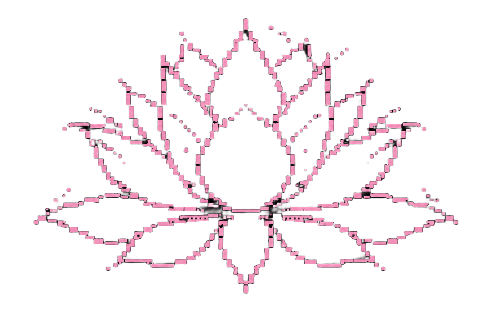
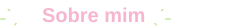
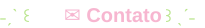
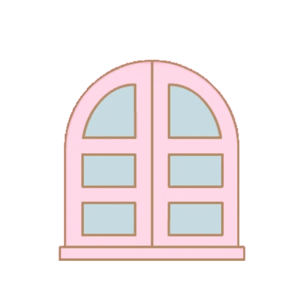

# 

<table>
<tr>
<td width="50%" align="center" valign="middle">
  
</td>
<td width="60%" valign="middle">

<h1></h1>

Estudante e Estagiária em Sistemas de Informação, apaixonada por tecnologia, criatividade e pelas diferentes possibilidades que a área de TI oferece.

Atualmente, estou explorando e aprimorando meus conhecimentos em diversas áreas, com maior interesse em Desenvolvimento Web, UX/UI Design e Desenvolvimento Full Stack. Ainda estou construindo minha trajetória profissional e descobrindo quais áreas mais combinam com meus objetivos e habilidades.

</td>
</tr>
</table>

---

## 

- ⋮ Estudante de Sistemas de Informação e estagiária na área de tecnologia.
- ⋮ Atualmente estudando e aprimorando meus conhecimentos em desenvolvimento e programação.
- ⋮ Interessada em Design Digital e UX/UI.
- ⋮ Explorando o universo do Desenvolvimento Web e Full Stack.
- ⋮ Gosto de ler e escrever sobre tecnologia.
- ⋮ Tenho interesse em participar de comunidades voltadas para mulheres na tecnologia.
- ⋮ Atualmente possuo dois projetos em desenvolvimento, que futuramente serão compartilhados por aqui.

## 

Atualmente, estou estudando e desenvolvendo minhas habilidades com:

  
  &nbsp;&nbsp;
  
  &nbsp;&nbsp;
  
  &nbsp;&nbsp;
  
  &nbsp;&nbsp;
  

  <strong>C++</strong>
  &nbsp;&nbsp;&nbsp;&nbsp;
  <strong>Python</strong>
  &nbsp;&nbsp;&nbsp;&nbsp;
  <strong>HTML5</strong>
  &nbsp;&nbsp;&nbsp;&nbsp;
  <strong>CSS3</strong>
  &nbsp;&nbsp;&nbsp;&nbsp;
  <strong>JavaScript</strong>

## 

**Em construção!**

Atualmente, estou desenvolvendo dois projetos que fazem parte do meu processo de aprendizado e evolução profissional. Em breve, eles estarão disponíveis aqui no GitHub.

Enquanto isso, este perfil continuará sendo atualizado conforme novos projetos e conhecimentos forem surgindo.

## 

- Desenvolvimento Web
- UX/UI Design
- Desenvolvimento Full Stack

## 

  
  &nbsp;&nbsp;&nbsp;&nbsp;
  

---

*Este perfil é um espaço para compartilhar minha evolução, meus projetos e tudo o que estou aprendendo ao longo da minha jornada na tecnologia ⭑.ᐟ*

  

  

